<div align="center">

# EuroSAT Geographic Generalization Study

**Does a land-cover classifier trained on western Europe still work in the east, and when spectral bands go missing?**<br>
Team SatX · RGB and 13-band Sentinel-2 ResNet-50 models, longitude-based splits and spectral-group dropout.

[](report/satx-final-report.pdf)


**[Findings](#key-findings) · [Method](#method) · [Results](#results) · [Spectral-Group Dropout](#spectral-group-dropout) · [Report](#report) · [My Role](#my-role) · [Reproduce](#reproduce)**

<picture>
  <source media="(prefers-color-scheme: dark)" srcset="docs/assets/split-map-dark.webp">
  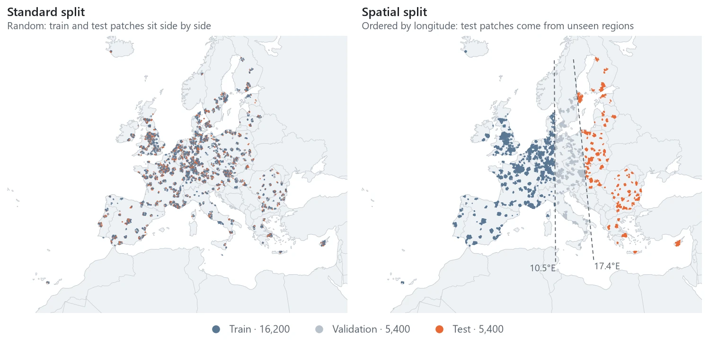
</picture>

</div>

> [!NOTE]
> Research project by team SatX at Georgia Tech (2026). Every number comes from single-seed runs (seed 42) saved in [`results/`](results/) and the experiment notebooks. Nothing on this page was run again.

A ResNet-50 scores 0.978 macro-F1 on EuroSAT's usual random split. Train it on patches west of 10.5°E and test it east of 17.4°E, and it drops to 0.916. The same model almost breaks when one group of spectral bands is missing. Without the visible bands, macro-F1 falls to 0.52. This project measures both problems. It then trains the model with **spectral-group dropout**, so the model learns not to depend on any single band group. The idea adapts channel dropout to Sentinel-2 band groups.

I planned and coordinated our four-person team and set up and maintained this repository. I built the multispectral baselines and their normalization. I designed, built and tested spectral-group dropout, and I ran the final experiments in the report.

## Key Findings

- 🌍 **[Spatial splits cost about 6 points](#geographic-gap):** Macro-F1 falls 6.1 points for RGB and 6.2 points for 13 bands when the test region changes. Extra bands help both splits by about the same amount, but they do not close the gap.
- 🛰️ **[Spectral-group dropout keeps the model working when bands go missing](#spectral-group-dropout):** Without the visible bands, macro-F1 rises from 0.52 to 0.84. Industrial F1 goes from 0.28 to 0.93, and Residential from 0.16 to 0.83. The cost is 2.0 points on clean images and small losses when atmospheric or SWIR bands are missing.
- 🌾 **[The gap lives in farmland](#where-the-gap-lives):** On one shared, fair test set, Permanent Crop drops from 0.94 to 0.75 F1 and Pasture from 0.79 to 0.65. Forest, Residential and Sea / Lake barely move.
- 📡 **[Noise training works across noise types](#sensor-noise):** In a teammate's study, training with shot noise lifts macro-F1 under Gaussian noise (σ = 0.1) from 0.53 to 0.87, with no loss on clean images.

## Method

<picture>
  <source media="(prefers-color-scheme: dark)" srcset="docs/assets/method-dark.svg">
  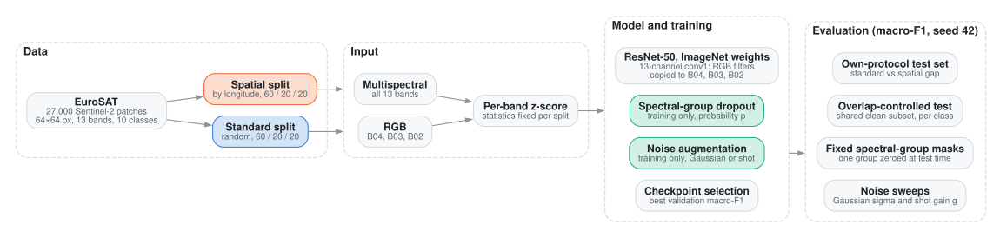
</picture>

**Two splits:** Both splits use fixed [train, validation and test lists](data/splits_data/) from TorchGeo, with 16,200, 5,400 and 5,400 patches. The standard split is random. The spatial split sorts patches by longitude. Training gets the west (up to 10.5°E), validation the middle, and testing the east (from 17.4°E). The map above shows this.

**13-band input:** The [model builder](src/satx/models/resnet.py) gives the first layer 13 input channels. It copies ImageNet's red, green and blue filters to B04, B03 and B02. The other ten channels start from the average of those filters. Each band is normalized with a fixed mean and standard deviation for its split.

**Fair test set:** Both splits use the same pool of images. So one split's test set can contain images from the other split's training set. The [cross-evaluation script](scripts/overlap_controlled_class_level_cross_eval.py) removes those images. All four baseline models are then tested on the same clean set.

<details>
<summary><b>Dataset</b></summary>

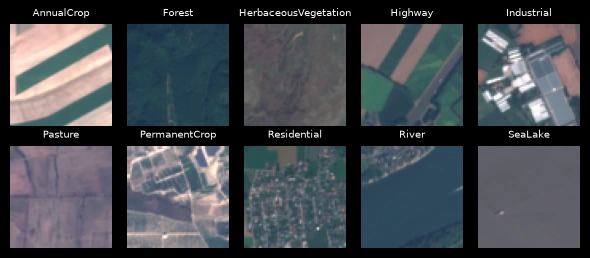

EuroSAT has 27,000 Sentinel-2 patches of 64 × 64 pixels in ten land-cover classes. Each patch has 13 spectral bands. RGB models use B04, B03 and B02. Multispectral models use all 13.

</details>

## Results

### Geographic gap

<picture>
  <source media="(prefers-color-scheme: dark)" srcset="docs/assets/geo-gap-dark.svg">
  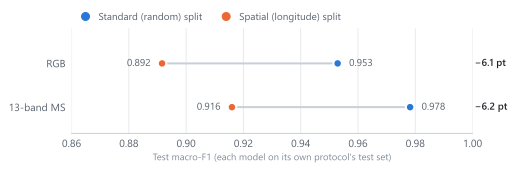
</picture>

**Same model, harder test:** Each model is tested on the test set of its own split. Accuracy drops only 3.2 points, but macro-F1 drops about twice as much. This means the shift hurts some classes much more than others. The two test sets contain different images, so the next section compares all models on the same images.

### Where the gap lives

<picture>
  <source media="(prefers-color-scheme: dark)" srcset="docs/assets/class-shift-dark.svg">
  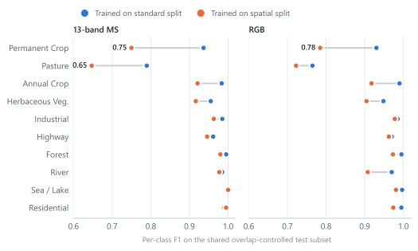
</picture>

**Farmland is the weak spot:** All four models are tested on the same unseen images. Farm classes lose the most when the model trains on the spatial split. Classes like Forest and Residential stay stable. Extra bands help River (0.91 to 0.98 for spatial models), but they do not help Pasture or Permanent Crop.

<details>
<summary><b>What the shift looks like in the data · mean spectra, west vs east</b></summary>

<picture>
  <source media="(prefers-color-scheme: dark)" srcset="docs/assets/spectra-dark.svg">
  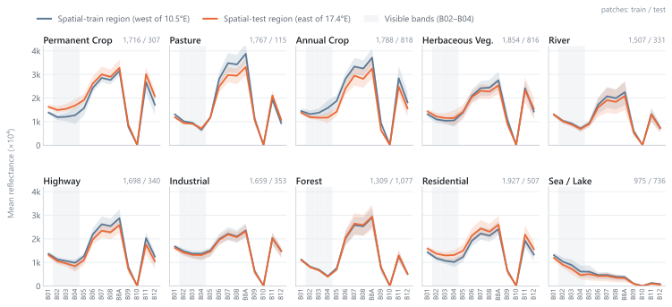
</picture>

Each line is the class average of each patch's mean band values. The shaded band covers the middle half of patches (25th to 75th percentile). Permanent Crop, Pasture and Annual Crop look clearly different in the east and the west. Forest and Industrial nearly overlap. The split also changes how many images each class has. Pasture has 1,767 training patches but only 115 test patches. These numbers come straight from the EuroSAT image files. They describe the data and do not prove a cause.

</details>

## Spectral-Group Dropout

A multispectral model can depend so much on a few bands that it fails without them. Our 13-band baseline depends heavily on the visible bands. This may be because its ImageNet filters start there. Remove those bands, and spatial-test macro-F1 drops from 0.92 to 0.52. Spectral-group dropout trains the model for this situation.

### How it works

<picture>
  <source media="(prefers-color-scheme: dark)" srcset="docs/assets/dropout-operation-dark.svg">
  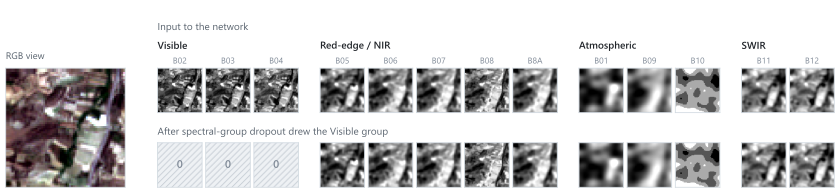
</picture>

During training, each sample is picked with probability *p*. A picked sample loses one of the four band groups, chosen at random. Every band in that group is set to zero. After normalization, zero is the band's average value, so the band carries no information. The other bands stay as they are. The goal is to act like a missing band, not like normal neural-network dropout. Dropout only runs during training. At test time, a band group is removed only when a test asks for it.

| Group | Bands |
| --- | --- |
| Visible | B02, B03, B04 |
| Red-edge / NIR | B05, B06, B07, B08, B8A |
| Atmospheric | B01, B09, B10 |
| SWIR | B11, B12 |

The groups are defined in [`band_info.py`](src/satx/data/band_info.py). The code checks that they use all 13 bands exactly once. The [dropout module](src/satx/models/spectral_group_dropout.py) has its own random seed, so the same run always drops the same groups. It also counts how often it drops each group in every epoch. At test time, [`fixed_group_mask.py`](src/satx/eval/fixed_group_mask.py) removes a chosen group in the same way.

### Choosing *p* without touching the test set

<picture>
  <source media="(prefers-color-scheme: dark)" srcset="docs/assets/dropout-sweep-dark.svg">
  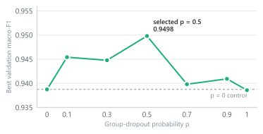
</picture>

There are seven 13-band runs on the spatial split, with *p* from 0 to 1. Everything else stays the same: seed, optimizer and 20 epochs. Validation macro-F1 is highest at *p* = 0.5 (0.950). With more masking, the model likely loses useful information too often. *p* = 0.5 is fixed before any test run.

### What it gains, and what it costs

<picture>
  <source media="(prefers-color-scheme: dark)" srcset="docs/assets/masks-dark.svg">
  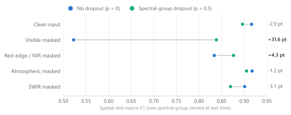
</picture>

<picture>
  <source media="(prefers-color-scheme: dark)" srcset="docs/assets/dropout-classes-dark.svg">
  
</picture>

**Strong where it matters most, but not everywhere:** Both models are tested on the same 5,400 spatial-test images. First on clean images, then with each band group removed. The biggest gains are in classes the baseline recognized almost only through the visible bands. Residential goes from 0.16 to 0.83, Industrial from 0.28 to 0.93, and Permanent Crop from 0.01 to 0.50. There are real costs too. Clean macro-F1 drops 2.0 points. Without SWIR, Permanent Crop falls from 0.78 to 0.56. One possible reason, not yet tested: dropout may move the model's dependence onto SWIR instead of removing it.

<sub>One training seed, so there are no confidence intervals. Setting a band group to zero is a simple test of missing bands. It does not cover every real sensor failure.</sub>

## Sensor noise

A teammate tested two kinds of input noise: Gaussian noise and shot (Poisson) noise. The test uses a separate 13-band model trained without normalization. Its clean macro-F1 is 0.898. A model trained with shot noise (gain 1) stays near 0.90 under mild noise of both kinds. Under Gaussian noise with σ = 0.1, it lifts macro-F1 from 0.53 to 0.87.

<details>
<summary><b>Noise sweep</b></summary>

<picture>
  <source media="(prefers-color-scheme: dark)" srcset="docs/assets/noise-dark.svg">
  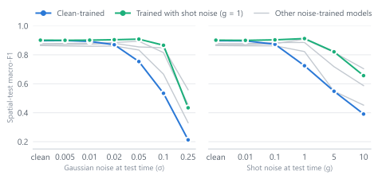
</picture>

</details>

## Report

<table>
<tr>
<td width="160" valign="top"><a href="report/satx-final-report.pdf">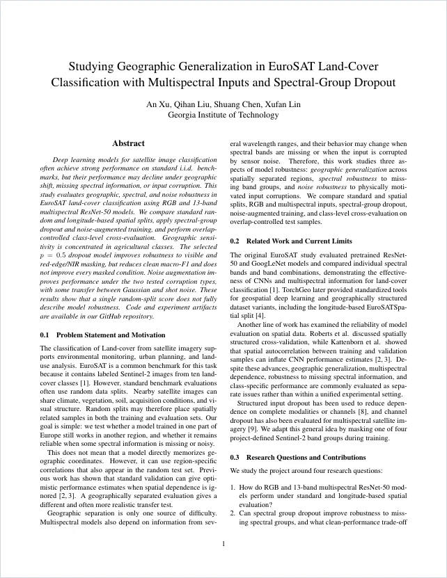</a></td>
<td valign="top">

**Studying Geographic Generalization in EuroSAT Land-Cover Classification with Multispectral Inputs and Spectral-Group Dropout**

An Xu, Qihan Liu, Shuang Chen, Xufan Lin · Georgia Institute of Technology

Four research questions in one shared setup: geographic splits, missing band groups, a fair class-level test and input noise. All experiments use the same models, split lists, checkpoint rule and metrics.

**[Read the PDF](report/satx-final-report.pdf)**

</td>
</tr>
</table>

## My Role

| Area | What I did | Evidence |
| --- | --- | --- |
| Project lead | Planned the study and split it into tasks. Set up the package, PR template and review process. Merged 11 of the 16 pull requests. | [Pull requests](https://github.com/WindHurtLZ/satx-eurosat-geographic-generalization-study/pulls?q=is%3Apr+is%3Amerged) |
| Spectral-group dropout | Designed the band groups and the dropout module. Ran the *p* sweep. Built the fixed-mask test and the per-class analysis. | [#13](https://github.com/WindHurtLZ/satx-eurosat-geographic-generalization-study/pull/13) · [`spectral_group_dropout.py`](src/satx/models/spectral_group_dropout.py) |
| Multispectral baselines | Added per-split normalization and configurable transforms. Trained the 13-band baselines. | [#10](https://github.com/WindHurtLZ/satx-eurosat-geographic-generalization-study/pull/10) · [`transforms.py`](src/satx/data/transforms.py) |
| Bug fixes | Fixed how the RGB filters map to B04, B03 and B02 in the 13-channel first layer. Made training repeatable with the same seed. | [#11](https://github.com/WindHurtLZ/satx-eurosat-geographic-generalization-study/pull/11) · [#12](https://github.com/WindHurtLZ/satx-eurosat-geographic-generalization-study/pull/12) |
| Experiments and report | Ran the final experiments, cleaned up the notebooks and put the report together. | [#15](https://github.com/WindHurtLZ/satx-eurosat-geographic-generalization-study/pull/15) · [#16](https://github.com/WindHurtLZ/satx-eurosat-geographic-generalization-study/pull/16) |

The rest of the team built the model builder and training engine, the dataset loader and split lists, the evaluation tools, the fair class-level test and the noise study.

## Reproduce

These are the original setup steps. They have not been run again on a fresh machine.

**1. Environment:** Python 3.11 with conda.

```bash
conda env create -f environment.yml
conda activate satx
python -m pip install torch torchvision torchgeo rasterio jupyterlab
python -m pip install -e .
python scripts/check_imports.py
```

**2. Data:** Download [`EuroSAT_MS.zip`](https://zenodo.org/records/7711810/files/EuroSAT_MS.zip) (2.1 GB) and unzip it to `data/EuroSAT_MS/`. The split lists are already in [`data/splits_data/`](data/splits_data/).

**3. Train:** Every run has a config file. For example, the selected dropout model:

```bash
python scripts/train.py configs/ms_spatial_dropout_p50.yaml
```

**4. Match the report:**

| Report | What to run | Results |
| --- | --- | --- |
| Table 1, geographic gap | [`rgb_*`, `ms_standard`, `ms_spatial`](configs/) configs, then [`SatX_Baseline_Exp`](notebooks/SatX_Baseline_Exp.ipynb) | Printed in the notebook |
| Figure 1, choosing *p* | The seven [`ms_spatial_dropout_*`](configs/) configs | [`w3_dropout_validation_summary.csv`](results/drop_out_experiment/w3_dropout_validation_summary.csv) |
| Table 2, missing bands | [`Group_Dropout_Exp`](notebooks/Group_Dropout_Exp.ipynb) | [`masked_group_metrics.csv`](results/drop_out_experiment/masked_group_metrics.csv), [`masked_group_per_class_f1.csv`](results/drop_out_experiment/masked_group_per_class_f1.csv) |
| Figure 2, fair class-level test | [`overlap_controlled_class_level_cross_eval.py`](scripts/overlap_controlled_class_level_cross_eval.py) | [`results/overlap_controlled_class_level_cross_eval/`](results/overlap_controlled_class_level_cross_eval/) |
| Table 3, noise | [`Noise_Exp`](notebooks/Noise_Exp.ipynb) | Printed in the notebook |

The notebooks are the original experiment logs, saved with their outputs. [docs/experiments.md](docs/experiments.md) has the full steps for each experiment. Run `pytest -q` for the unit tests. They do not need the dataset.

## Repository

```text
configs/      One YAML file per training run
data/         Split lists (the dataset itself is not in Git)
docs/         Architecture and experiment guides, README figures
notebooks/    Original experiment notebooks with outputs
report/       Final report (PDF)
results/      Result tables used in the report
scripts/      Training, grid search and the fair class-level test
src/satx/     Python package: data, models, training, evaluation
tests/        Unit tests
```

[docs/ARCHITECTURE.md](docs/ARCHITECTURE.md) explains each module and what happens in one training run.

## References

1. P. Helber, B. Bischke, A. Dengel and D. Borth. EuroSAT: A Novel Dataset and Deep Learning Benchmark for Land Use and Land Cover Classification. *IEEE JSTARS*, 2019. [doi:10.1109/JSTARS.2019.2918242](https://doi.org/10.1109/JSTARS.2019.2918242)
2. D. R. Roberts et al. Cross-validation strategies for data with temporal, spatial, hierarchical, or phylogenetic structure. *Ecography*, 2017. [doi:10.1111/ecog.02881](https://doi.org/10.1111/ecog.02881)
3. T. Kattenborn, F. Schiefer, J. Frey, H. Feilhauer, M. D. Mahecha and C. F. Dormann. Spatially autocorrelated training and validation samples inflate performance assessment of convolutional neural networks. *ISPRS Open Journal of Photogrammetry and Remote Sensing*, 2022. [doi:10.1016/j.ophoto.2022.100018](https://doi.org/10.1016/j.ophoto.2022.100018)
4. A. J. Stewart, C. Robinson, I. A. Corley, A. Ortiz, J. M. Lavista Ferres and A. Banerjee. TorchGeo: Deep Learning with Geospatial Data. *ACM SIGSPATIAL*, 2022. [doi:10.1145/3557915.3560953](https://doi.org/10.1145/3557915.3560953)
5. K. He, X. Zhang, S. Ren and J. Sun. Deep Residual Learning for Image Recognition. *CVPR*, 2016. [doi:10.1109/CVPR.2016.90](https://doi.org/10.1109/CVPR.2016.90)
6. O. Russakovsky et al. ImageNet Large Scale Visual Recognition Challenge. *IJCV*, 2015. [doi:10.1007/s11263-015-0816-y](https://doi.org/10.1007/s11263-015-0816-y)
7. D. Hendrycks and T. Dietterich. Benchmarking Neural Network Robustness to Common Corruptions and Perturbations. *ICLR*, 2019. [arXiv:1903.12261](https://arxiv.org/abs/1903.12261)
8. N. Neverova, C. Wolf, G. W. Taylor and F. Nebout. ModDrop: Adaptive Multi-Modal Gesture Recognition. *IEEE TPAMI*, 2016. [doi:10.1109/TPAMI.2015.2461544](https://doi.org/10.1109/TPAMI.2015.2461544)
9. S. Illarionova, S. Nesteruk, D. Shadrin, V. Ignatiev, M. Pukalchik and I. Oseledets. MixChannel: Advanced Augmentation for Multispectral Satellite Images. *Remote Sensing*, 2021. [doi:10.3390/rs13112181](https://doi.org/10.3390/rs13112181)
